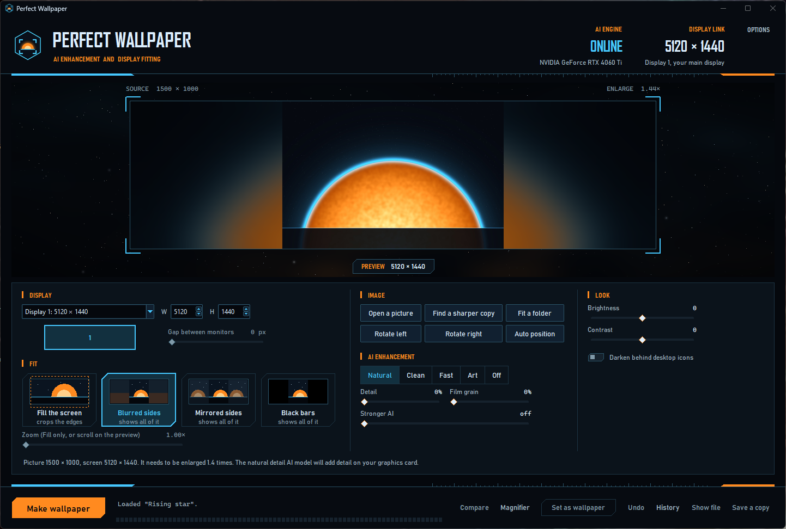

# Perfect Wallpaper

Drop in any picture and Perfect Wallpaper turns it into a wallpaper that fits your screen exactly. It detects your screen size, and if the picture is too small, an AI enlarges it on your graphics card so it stays sharp instead of blurry. If the picture's shape doesn't match your screen, you choose what happens: crop it to fill the screen, or show all of it with blurred sides, mirrored sides or black bars. One click then sets it as your wallpaper, and another puts the old one back.

It works with any screen, from a laptop to a 32:9 super ultrawide or several monitors combined into one picture. The window is styled like a starship console, because the project started with a space scene that needed to fit a 5120 × 1440 monitor.



## Download

Perfect Wallpaper runs on Windows 10 and 11. The [Releases](../../releases) page has two downloads:

- **PerfectWallpaper-Setup** installs the program for your user account, with no administrator rights. It opens in under 2 seconds, adds a Start menu entry, and can add a desktop icon and a "Make a perfect wallpaper" entry to the right click menu for pictures.
- **PerfectWallpaper.exe** is a single portable file that runs without installing. It takes about 5 seconds to open, because it unpacks itself each time.

The AI needs a graphics card that supports Vulkan, which includes nearly every NVIDIA, AMD and Intel graphics card from the last ten years. The window shows **AI ENGINE ONLINE** and the card's name when it found one. On a laptop with two graphics chips it picks the faster one. Without one, the program still works and resizes pictures without AI.

The program isn't signed with a paid certificate, so Windows may warn you the first time you run it. Click **More info**, then **Run anyway**.

## How to use it

1. **Open a picture.** Drop it onto the window, click the empty screen, paste it with Ctrl+V, drop it onto the program's icon, or right click a picture in File Explorer and choose "Make a perfect wallpaper." iPhone photos (HEIC) work too.
2. **Check the display.** It starts on your main display. With several monitors, click one on the little map, or choose all of them as one picture. When spanning several monitors, the **gap** setting keeps lines straight across the frames between them.
3. **Choose how it fits.** **Fill the screen** crops the edges: drag the preview to choose what stays in view, scroll on it to zoom in, or press **Auto position** (which looks for faces first). **Blurred sides**, **mirrored sides** and **black bars** show the whole picture.
4. **Choose the AI.** **Natural** keeps fine texture and suits photos and game art. **Clean** gives smooth results with little noise. **Fast** is about five times quicker. **Art** is for drawings and anime. **Detail** adds back the original's own fine texture, and **film grain** hides softness on a big screen.
5. **Adjust the look** if you like: brightness, contrast, and darkening behind the desktop icons so their names stay readable.
6. Press **Make wallpaper**. It is saved in your Pictures folder, under `Perfect Wallpaper`, and never overwrites an earlier one.
7. Press **Set as wallpaper**. **Undo** puts your previous wallpaper back, and **History** shows every wallpaper you made.

Before setting it, **Compare** shows the finished wallpaper at full size beside a plain resize (move the mouse to sweep between them), and the **Magnifier** shows any spot at full size, without and with the AI, even before you make it.

### More

- **Find a sharper copy** searches Wallhaven, a free wallpaper site, for bigger copies of your picture. It recognizes the same picture even when cropped or resized, and says how much sharper each one would look on your screen. For the rest of the web it copies your picture so you can paste it into Google Lens or Bing Visual Search.
- **Fit a folder** makes a wallpaper from every picture in a folder, and can hand them to Windows as a slideshow.
- **The stronger AI** (optional, about 6 GB to download, NVIDIA cards only) repaints the picture with Stable Diffusion and adds its finest texture to the result. The difference is subtle and it takes a few minutes per wallpaper. Set it up from the Options menu or the Stronger AI slider.

### Keyboard shortcuts

| Key | Does |
|---|---|
| Enter | Make the wallpaper |
| Esc | Cancel, or leave Compare and the Magnifier |
| R, Shift+R | Rotate right, rotate left |
| 1 to 4 | Fill, blurred sides, mirrored sides, black bars |
| C, M | Compare, Magnifier |
| Ctrl+O, Ctrl+V | Open a picture, paste a picture |
| Ctrl+W, Ctrl+Z | Set as wallpaper, Undo |
| Ctrl+F, Ctrl+H, Ctrl+S | Find a sharper copy, History, Save a copy |

The program remembers your choices between runs. If something goes wrong, the log file (Options, Open the log folder) has the details to send along.

## How it works

The AI models run through [ncnn](https://github.com/Tencent/ncnn), a small library that uses any graphics card with Vulkan. A helper process keeps them loaded while the window is open, so only the first wallpaper waits for them to load. Every model enlarges a picture four times, so the program enlarges four times and then shrinks the result to the exact screen size, which keeps the AI's detail. In Fill mode it enlarges only the part that will show. A picture that needs more than six times its size gets a second AI pass, and one that is already big enough is simply shrunk.

The models were picked in a side by side test on game art and photos: Nomos8kSC and LSDIRplusC by Helaman, and Real-ESRGAN's General and anime models. AI enlarging works best on pictures that are small or compressed; it can't rescue a picture that is out of focus.

## Command line

```
python -m perfect_wallpaper picture.jpg --size 5120x1440 --fit blur --set
python -m perfect_wallpaper picture.jpg --size all --gap 40 --model clean
python -m perfect_wallpaper "C:\My pictures" --fit mirror --slideshow 30
```

Run `python -m perfect_wallpaper --help` for every option.

## Running from source

You need Python 3.12 on Windows.

```
python -m venv .venv
.venv\Scripts\activate
pip install -r requirements.txt -r requirements-build.txt -r requirements-models.txt
python scripts/get_engine.py
python scripts/convert_models.py
python -m perfect_wallpaper
```

`scripts/get_engine.py` downloads the Real-ESRGAN engine, and `scripts/convert_models.py` makes the other AI models from their authors' original files; both check every download against a known checksum. The model conversion needs PyTorch, but only while converting; the program itself doesn't. `powershell -ExecutionPolicy Bypass -File scripts\desktop_shortcut.ps1` puts a desktop icon that starts the program from your copy of the code.

Run the tests with `python -m unittest discover -s tests`. `python scripts/build.py` builds both downloads into `dist`; the installer needs [Inno Setup 6](https://jrsoftware.org/isinfo.php). Pushing a version tag such as `v0.1.0` makes GitHub Actions build both and publish them as a release.

The code is organized by job: `fitting.py` places a picture on a screen, `upscale.py` and `engine_server.py` run the AI, `pipeline.py` puts the steps together, `adjust.py` does the look, `search.py` finds sharper copies, `wallpaper.py` and `screens.py` talk to Windows, and `app.py`, `ui.py` and `dialogs.py` are the window.

## License and credits

Perfect Wallpaper is free and open source under the [MIT License](LICENSE). The console look is original and isn't affiliated with any game or studio. The AI models come from the Real-ESRGAN project by Xintao Wang and from Helaman, and are used under their BSD and Creative Commons licenses. [THIRD_PARTY_NOTICES.md](THIRD_PARTY_NOTICES.md) lists everything the program bundles or downloads.
